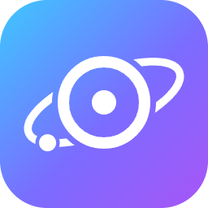

# BitMusic

### The music player that takes your songs apart.

**Separate any song into drums, bass, vocals and instruments — on your own PC.
Sing it with word-by-word karaoke. Mix it on a real DJ controller. Share it
peer-to-peer with your friends.**

No subscription. No streaming account. No cloud. Your files never leave your computer.

-informational)

*Created by **Eduardo Javier Olórtigue Samanamud** · part of the **BitStation** ecosystem*

---

## Why BitMusic is not another music player

Every streaming app gives you the same thing: a song, a play button, and a
monthly bill. BitMusic gives you the **inside** of the song.

Here is what BitMusic does that Spotify, Apple Music, YouTube Music and Tidal
**cannot do at all** — because they will never let you touch the master:

| | BitMusic | The streaming apps |
|---|---|---|
| **Split any song into 4 stems** (drums · bass · vocals · other) | ✅ On your PC, for *your own* files | ❌ Not possible |
| **Remove the vocals of any track** and sing over the real instrumental | ✅ Real separation, not a karaoke re-recording | ❌ Only official karaoke tracks, if any |
| **Word-by-word karaoke timing** generated from the audio itself | ✅ AI forced alignment | ⚠️ Line-by-line lyrics at best |
| **Mix with a physical DJ controller** using separated stems | ✅ Hercules DJControl Starlight / Inpulse 500 | ❌ Not possible |
| **AI auto-mixing** between your songs by key, BPM and genre | ✅ Atom engine | ⚠️ Simple crossfade |
| **Music video blended into the visuals**, synced to your audio | ✅ | ❌ |
| **Share your library and playlists directly with friends** | ✅ Peer-to-peer, no upload to anyone's server | ❌ |
| **Works fully offline** | ✅ | ❌ |
| **Owns your files** | ✅ Always yours | ❌ Access ends with the subscription |
| **Price** | **Free** | $10–12 / month, forever |

---

## What you can do with it

### 🎚️ Take the song apart — on your machine
BitMusic separates any track into **four independent stems** using a Demucs v4
neural network that runs **locally**. It works on any PC with the CPU engine, and
if you have an NVIDIA GPU it uses CUDA for a large speed-up. Mute the vocals to
get a real instrumental. Solo the drums to learn a groove. Push the bass up.
Nothing is uploaded anywhere.

### 🎤 Karaoke that actually follows you
Synchronised lyrics are fetched automatically. Then BitMusic goes further: it
listens to the **isolated vocal stem** and aligns the lyrics **word by word**
with an MMS forced-alignment model, so the highlight moves with the singer
instead of jumping line to line. Timing drift can be nudged live, per song, and
the correction is remembered.

### 🎧 A real DJ booth (DJ Pro)
Two decks, beat-accurate scheduling and **stem-level crossfading** — bring in
the next track's drums before its vocals. Plug in a **Hercules DJControl
Starlight** or **Inpulse 500** and the jog wheels, faders, pads and pitch
sliders map straight in, with LED feedback. MIDI-learn is built in for anything
else. There is a vinyl-style scratch mode, a beat grid, waveform timelines and
an Auto/Manual transition toggle.

### 🪐 Atom — automatic sets that make musical sense
Atom picks the next song using the **circle of fifths**, BPM proximity and a
genre tree, then builds a real transition (anchor + tight blocks + a shift
block) instead of a blind fade. It is the closest thing to a DJ that knows your
library.

### 📺 Music videos, dissolved into the room
BitMusic finds the official music video for the song you are playing and blends
it **into** the animated light field — never as a rectangle floating on top. The
video is muted and slaved to BitMusic's own audio clock, frame-synced, with
disk caching and next-track prefetching so a gapless mix stays gapless.

### 🌐 Your own private music network
Turn your library into a share and let your friends browse it: **BitMusic
Network** connects peers directly (P2P), with a lightweight tracker that only
stores *who is online*, never your music. You can:

- publish albums, or **publish your own playlists as their author**,
- audition a **30-second preview** before downloading anything,
- download a full album, a single song, or a whole curated playlist,
- keep your profile picture on everything you share.

Downloading someone's playlist is smart: songs you already own are **reused**,
and only what is missing is transferred — into the **real artist and album**
they belong to, never a duplicate folder.

### ✨ And the details that make it feel finished
- **Every song at the same volume** — proper loudness normalisation (BS.1770-style
  gated measurement) with a true peak limiter, so a 1970s master and a modern
  one land at the same level.
- **HD artwork, automatically** — covers are fetched at the highest resolution
  the sources actually serve, and low-resolution covers already in your library
  get upgraded in the background.
- **Artist photos**, fetched and cached, with a manual override.
- **Neon Mesh interface** with a real light theme, a WebGL light field that
  reacts to each stem, and a mini player.
- **Windows taskbar controls** under the thumbnail preview.
- **10-band EQ**, mixer, favourites, play counts, smart playlists.
- **Music Quiz** — a stem-reveal guessing game built from your own library.
- **Artist packs** — export an artist as a single `.png` that is secretly a full
  archive, and drag it onto a friend's BitMusic to import it.
- **Auto-update** — BitMusic tells you when a new version exists and installs it
  for you in one click.

---

## Install

1. Download the latest **`BitMusic-Setup-x.y.z.exe`** from the
   [releases page](https://github.com/BitStationBusiness/BitMusic/releases/latest).
2. Run it and accept the Windows prompt.
3. That is it — it installs to `C:\BitMusic` and opens itself.

**Requirements:** Windows 10 or 11 (64-bit). Everything needed is inside the
installer — no Python, no runtimes, no extra downloads. An NVIDIA GPU is
optional and only makes the stem separation faster.

From then on, BitMusic checks for updates every time you open it and offers them
to you. Nothing installs itself behind your back.

---

## Roadmap

- **Right now: Windows only.** BitMusic is a native Windows application, and
  that is the only supported platform today.
- **Android is being worked on** for the future, so your library and your
  playlists can travel with you.
- More ideas, in no particular order: extra DJ controllers, more stem models,
  and deeper sharing between friends.

---

## ☕ Keep the BitStation tools free

BitMusic is **free, with no ads, no accounts you have to pay for, and no
subscription** — and it is built by one person.

Everything in the BitStation ecosystem is meant to stay that way. What it costs
is real: the servers behind the sharing network, code-signing certificates,
hardware to test on, and a great many nights of work.

If BitMusic saved you a subscription, consider buying a coffee instead. Even a
small one keeps the next feature coming — and you can also do it from inside the
app: press the **☕ button** in the title bar.

### 

**Every coffee goes straight back into development.**
One-time, no account required, and you can leave a message with the feature you
want next — those get read first.

Not into coffee? A ⭐ on this repository and telling a friend about BitMusic
helps more than you would think.

---

**BitMusic** · Created by **Eduardo Javier Olórtigue Samanamud** · **BitStation**

BitMusic plays the music you already own. It does not provide, stream or
distribute copyrighted material — what you do with your own files is up to you.
Artwork, lyrics and artist images are retrieved from public catalogues and belong
to their respective owners.

